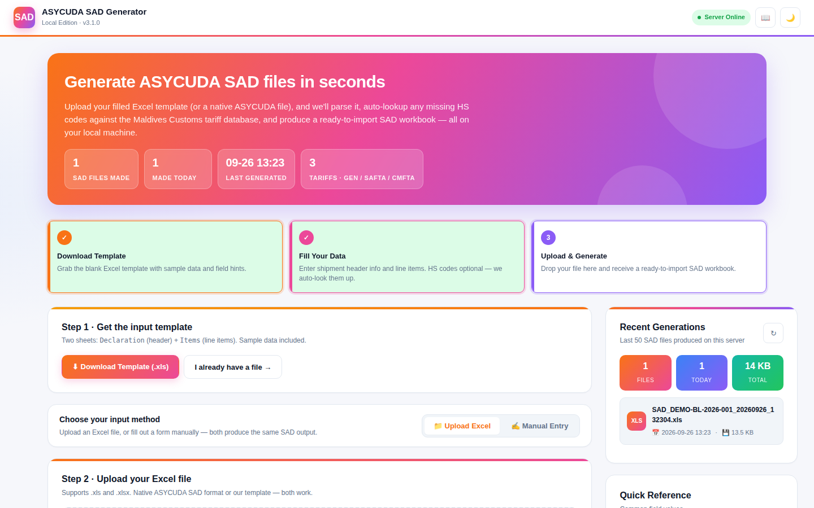
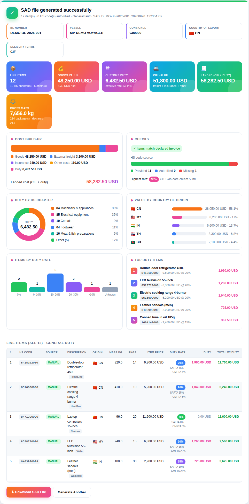
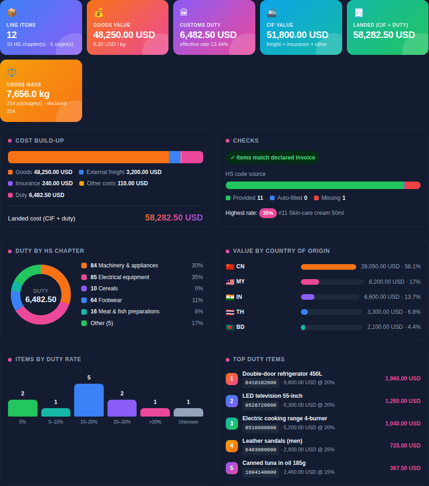
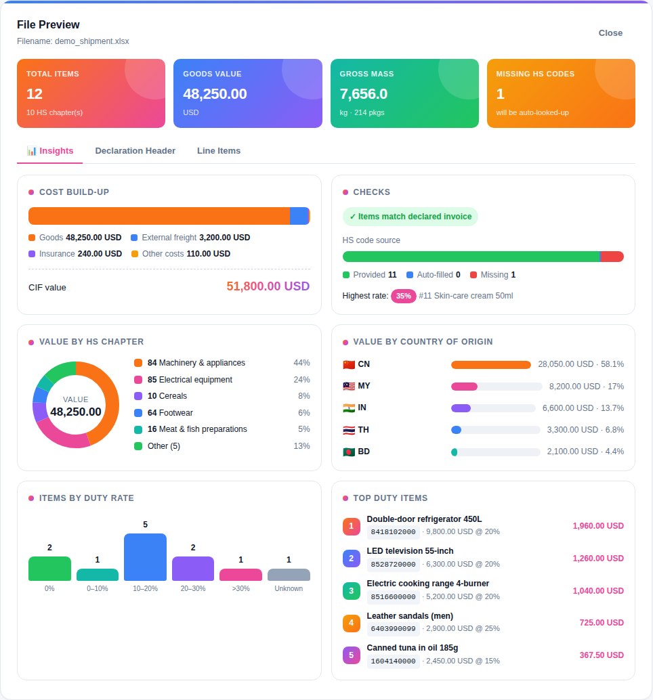

# ASYCUDA SAD Generator

Turn a **scanned supplier invoice**, a shipment spreadsheet or a quick web form into a ready-to-import **ASYCUDA++ SAD** workbook — with HS codes and customs duty looked up automatically from the **Maldives Customs** online tariff.

Runs on your own computer. No accounts, no credits. Scanning is free; an optional Anthropic API key makes it smarter.



---

## What it does

- **Scan invoice → SAD** (new in 3.4): drop scanned or photographed invoices, packing lists and B/Ls (PDF, JPG, PNG, WebP). The declaration header and every line — description, quantity, unit, unit price, line total, packages, weights, brand, model, origin — are read into the SAD form for you to check. See [Scanning invoices](#scanning-invoices).
- **Excel → SAD**: upload the SAD model, the simple template or a previously generated SAD (`.xls` / `.xlsx`) and download the **official ASYCUDA SAD model filled in** — same sheets, formatting, dropdowns and field hints as the original model, ready to import.
- **Duty & revenue in MVR**: duty = item price × duty % × MVR rate, revenue = item price × MVR rate × 1%, using the [Maldives Customs exchange rate](https://customs.gov.mv/eServices/exchangeRate) (fetched automatically, or type your own).
- **Duty worksheet**: a second download with item-by-item duty rate, duty amount and IPV tax lines.
- **Manual entry**: fill the declaration and line items in the browser instead of Excel.
- **HS code auto-fill**: items with no commodity code are matched by description against the Maldives Customs tariff.
- **Duty calculation**: duty rate (box 43), duty amount and IPV tax lines (box 47) for every item, with a choice of **General**, **SAFTA** or **CMFTA** rates.
- **Command line** mode for batch or scripted use — no browser needed.
- **Shipment dashboard**: goods / CIF / landed cost, effective duty rate, duty by HS chapter, value by origin country, rate bands, top dutiable items, and checks against the declared invoice total and package count — on every result and in the file preview.
- **History** of generated files, downloadable from the sidebar.

## Screenshots

**Results dashboard** — cost build-up, duty by HS chapter, value by origin, rate bands, top duty items and checks:



<table>
<tr>
<td width="50%"><b>Dark mode</b><br></td>
<td width="50%"><b>File preview · Insights tab</b><br></td>
</tr>
</table>

<sub>Screenshots use made-up demo data.</sub>

## Quick start (Windows)

**Option A — no Python needed:** download `ASYCUDA_SAD_Generator.exe` from the [latest release](../../releases) (or the *Build Windows .exe* workflow's artifacts) and double-click it. Your browser opens at <http://localhost:8000>. Generated files go to a `sad_output` folder next to the `.exe`.

**Option B — from source:**

1. Install [Python 3.10+](https://www.python.org/downloads/windows/) (tick **Add Python to PATH**).
2. Download this repository (green **Code** button → *Download ZIP*) and unzip it.
3. Double-click **`start_sad_generator.bat`**. The first run installs dependencies; after that it starts in seconds.
4. Optional: double-click **`create_desktop_shortcut.bat`** for a desktop icon. **`stop_sad_generator.bat`** stops a running server.

To build your own `.exe`, run **`build_exe.bat`**.

## Quick start (macOS / Linux)

```bash
python3 -m venv .venv && source .venv/bin/activate
pip install -r requirements.txt
python sad_generator_local.py            # opens http://localhost:8000
```

## Command line

```bash
python sad_generator_local.py --help

# Web app (default). Use --host 0.0.0.0 to let other computers on your network connect.
python sad_generator_local.py serve --port 8000 [--host 0.0.0.0] [--output-dir D:\SADs] [--no-browser]

# Convert one file without the browser
python sad_generator_local.py generate shipment.xlsx -o SAD_out.xls --preferential safta
python sad_generator_local.py generate shipment.xlsx --no-lookup     # offline: skip tariff lookups
python sad_generator_local.py generate shipment.xlsx --rate 15.42     # set the MVR exchange rate

# Write a blank SAD model (or the simple template with --simple)
python sad_generator_local.py template -o SAD_MODEL.xls
```

The `.exe` accepts the same commands, e.g. `ASYCUDA_SAD_Generator.exe generate shipment.xlsx`.

## Scanning invoices

Choose **📷 Scan Invoice**, drop the documents, and press **Read documents**. The form fills in and opens for review; a **📄 Scanned pages** button lets you check each value against the page. Highlighted fields need a closer look (low-confidence HS code, weight spread from the shipment total, description over ASYCUDA's 49 characters).

| | Free reading (default) | With an Anthropic API key |
|---|---|---|
| How | OCR in your browser (Tesseract.js); digital PDFs use their own text | Claude reads the page images / PDFs |
| Good at | Clear, typed invoices with one line per item | Any layout, photos, stamps, multi-page invoices |
| Packing lists | Not merged | Weights and packages copied onto the matching lines |
| HS codes | Searched in the tariff by description | Claude suggests a heading; the best national code under it is picked from the tariff |
| Cost | Free (needs internet once to download the reader) | Billed to your key, usually cents per invoice |

To use Claude, paste a key from [console.anthropic.com](https://console.anthropic.com) into **Reading settings** (it stays in that browser), or set `ANTHROPIC_API_KEY` before starting the app so everyone on your network uses it.

Always check the lines, HS codes and weights before lodging — the checks panel flags totals that don't add up.

## Input format

**SAD model (recommended).** Download it from the app (**⬇ SAD Model**) or with `python sad_generator_local.py template`. It is the same workbook the app outputs: fill the *General Segment* values (column C, currency in D) and one item per row on the *Items* sheet from row 4. Comments on the header cells explain each field; dropdowns and length limits come from ASYCUDA.

The model file lives in `sad_generator/templates/SAD_MODEL.xls`. To use an updated model, replace that file or set `SAD_MODEL_PATH`.

**Simple template.** A flat alternative (`template --simple`) with two sheets:

| Sheet | Layout | Key columns |
|---|---|---|
| `Declaration` | headers in row 1, values in row 2 | `bl_number`, `vessel_name`, `exporter`, `consignee_code`, `country_of_export`, `delivery_terms`, `invoice_amount`, `invoice_currency`, freight/insurance, … |
| `Items` | headers in row 1, one item per row | `hs_code`, `description`, `country_origin`, `gross_mass`, `item_price`, `no_packages`, packing, brand/model, … |

Common alternative headers are recognised too (`HS Code`, `Commodity code`, `Commercial description`, `Country of origin`, `Price`, `No. of packages`, …). Leave `hs_code` blank to have it looked up from the description.

HS codes that Excel has turned into numbers (e.g. `0603120011` → `603120011`) are repaired automatically.

A SAD generated by this tool can be uploaded again — edit it in Excel and regenerate.

## Configuration

Environment variables (all optional):

| Variable | Default | Purpose |
|---|---|---|
| `SAD_HOST` / `SAD_PORT` | `127.0.0.1` / `8000` | Web server address |
| `SAD_OUTPUT_DIR` | `./sad_output` (next to the `.exe` when bundled) | Where SAD files are saved |
| `SAD_HS_TIMEOUT` | `15` | Seconds per tariff request |
| `SAD_HS_MAX_CONCURRENCY` | `4` | Parallel tariff requests |
| `SAD_HS_CACHE_TTL` | `21600` | Seconds to cache tariff results |
| `SAD_MAX_UPLOAD_MB` | `20` | Upload size limit |
| `SAD_MODEL_PATH` | bundled `SAD_MODEL.xls` | SAD model used for the download |
| `SAD_FX_URL` | Customs exchange-rate page | Where MVR rates are read from |
| `SAD_REVENUE_RATE` | `0.01` | Revenue = price × MVR rate × this |
| `ANTHROPIC_API_KEY` | — | Lets *Scan invoice* use Claude for everyone (a key typed in the browser also works) |
| `SAD_SCAN_MODEL` | `claude-sonnet-5` | Claude model used for scanning |
| `SAD_SCAN_TIMEOUT` | `180` | Seconds to wait for Claude |
| `SAD_SCAN_MAX_FILES` | `20` | Files per scan |

## API

Interactive docs at <http://localhost:8000/docs>. Main endpoints:

| Method | Path | |
|---|---|---|
| `POST` | `/generate?preferential=general\|safta\|cmfta` | Upload Excel → SAD |
| `POST` | `/api/generate-manual` | JSON `{general, items, preferential}` → SAD |
| `POST` | `/api/preview` | Parse an upload without generating (includes `analytics`) |
| `POST` | `/api/scan` | Scanned documents (multipart `files`) → form data, read by Claude (`X-Anthropic-Key` header or server key) |
| `POST` | `/api/scan-text` | JSON `{text}` from OCR / a PDF text layer → form data |
| `GET` | `/api/scan/status` | Whether a server-side API key is set |
| `GET` | `/api/hs-lookup?description=…` | HS code search (with duty / SAFTA / CMFTA rates) |
| `GET` | `/api/hs-tariff/{hs_code}` | Tariff for one code |
| `GET` | `/api/history` · `/output/{file}` · `DELETE /output/{file}` | Generated files |
| `GET` | `/download-model[?sample=true]` | Blank SAD model (or with sample rows) |
| `GET` | `/download-template` · `/api/health` | Simple template · status |

## Project layout

```
sad_generator/
  app.py          FastAPI routes
  cli.py          serve / generate / template commands
  service.py      generate pipeline shared by web + CLI
  invoice_scan.py read scanned invoices (Claude or OCR text) into form data, tariff-anchored HS codes
  excel_io.py     read template, native and generated SAD workbooks
  sad_model.py    fill the ASYCUDA SAD model (the main download)
  xls_template.py edit .xls cells in place, keeping dropdowns & comments
  sad_builder.py  write the duty worksheet and the simple template
  templates/SAD_MODEL.xls  the ASYCUDA SAD model
  hs_lookup.py    Maldives Customs tariff search (cached, rate-limited)
  duty.py         duty calculation and totals
  static/index.html   the web UI
sad_generator_local.py   launcher (used by the .bat files and PyInstaller)
tests/                   pytest suite (runs offline)
```

## Development

```bash
pip install -r requirements-dev.txt
pytest -q
ruff check .
```

GitHub Actions runs the tests on Windows and Linux for every push. The **Build Windows .exe** workflow can be run by hand from the *Actions* tab; pushing a tag such as `v3.0.0` also attaches the `.exe` to a GitHub Release.

## Notes

- HS codes and rates come from scraping <https://www.customs.gov.mv/eServices/findtariff>. If the site changes its layout or is unreachable, lookups return nothing and the SAD is still generated — **always check codes and duty before lodging a declaration**.
- Duty is calculated as `item price × rate`; freight, insurance and other taxes (GST etc.) are not included in the duty figure.

See [CHANGELOG.md](CHANGELOG.md) for what changed in v3.
